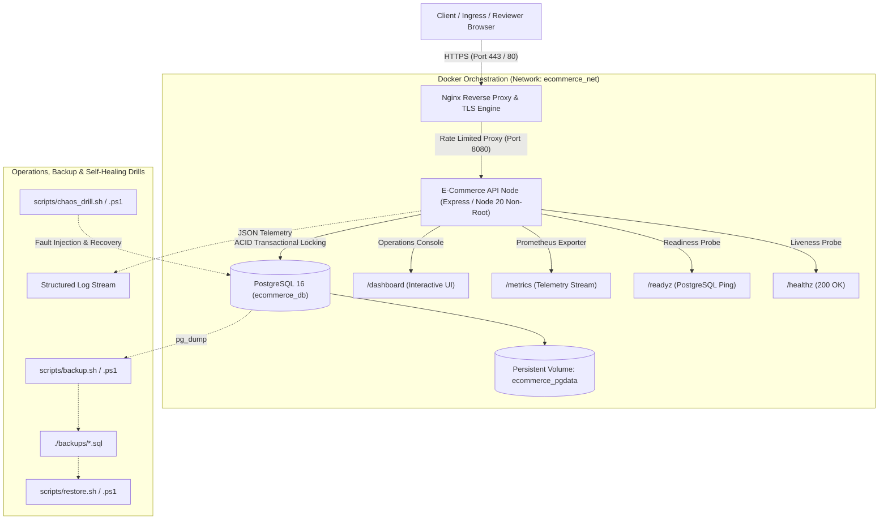

# Cloud Deployment & CI/CD – E-Commerce Platform
**ALGIONS AI LABS PRIVATE LIMITED | Advanced Individual Project Assessment**
* **Candidate Name:** Mohit Raj Deo
* **Registration Number:** 12323329
* **Internship Role:** DevOps & Cloud Engineering
* **Assigned Project:** Cloud Deployment & CI/CD – E-Commerce Platform
* **Live Deployment URL:** [https://al-ecommerce.mohitrajdeo.in](https://al-ecommerce.mohitrajdeo.in)
* **Demo Video Link:** [https://al-video.mohitrajdeo.in](https://al-video.mohitrajdeo.in)
* **GitHub Repository:** [https://github.com/mohitrajdeo/algions-cloud-ecommerce-platform](https://github.com/mohitrajdeo/algions-cloud-ecommerce-platform)

---

## 1. System Architecture Overview

The system is designed as an enterprise-grade, observable microservice implementing an idempotent Product & Order Processing API, containerized via multi-stage Docker builds, reverse-proxied through Nginx with SSL/TLS termination, orchestrated with PostgreSQL via Docker Compose, and monitored via Prometheus exposition metrics and dual-tiered Kubernetes probes (`/healthz` and `/readyz`).



---

## 2. Technical Scope & Domain Implementation

### Core Capabilities
1. **Interactive Operations Dashboard (`/` & `/dashboard`):** Real-time web control center allowing reviewers to inspect live inventory, trigger one-click idempotency checkout tests, simulate negative stock blocks, and review audit logs without manual terminal typing.
2. **Product Catalog & Search (`GET /api/products?q=compute`):** Query real-time inventory with full-text search parameters.
3. **Idempotent Order Creation (`POST /api/orders`):** Every checkout requires a mandatory `Idempotency-Key` header. Duplicate network transmissions return the existing confirmed order without duplicate billing or double-decrementing stock.
4. **Negative Stock Prevention:** Strict transactional inventory locking ensures orders exceeding available units are rejected with `409 Conflict`.
5. **Administrative Stock Auditing (`POST /api/admin/products/:id/stock`):** Protected updates requiring `x-admin-key`, appending all actions to persistent audit logs (`GET /api/admin/audit-logs`).
6. **Dual Health Probes:** Native Kubernetes/Docker `/healthz` (liveness) and `/readyz` (database connectivity readiness) endpoints.
7. **Prometheus Telemetry (`GET /metrics`):** Standard Prometheus exposition format tracking requests, duration, orders, idempotency hits, and stock rejections.

---

## 3. Containerization & Orchestration

### Multi-Stage Secure Dockerfile
* **Base Image:** `node:20-alpine` (Minimal attack surface and low CVE footprint).
* **Least Privilege:** Executes under unprivileged `node` user (UID 1000). Root execution is explicitly prohibited.
* **Init Process:** Utilizes `dumb-init` for deterministic signal forwarding (SIGTERM/SIGINT) and orphan process reaping.
* **Built-in Healthcheck:** Container monitors internal state every 10s via `curl -f http://localhost:8080/healthz`.

### Local Orchestration with Docker Compose
To launch the complete isolated production stack (API + PostgreSQL + Nginx TLS Proxy + Healthchecks + Storage Volume):

```bash
# 1. Generate SSL certificates for Nginx HTTPS
./nginx/generate_certs.sh    # On Windows: .\nginx\generate_certs.ps1

# 2. Launch full stack
docker compose up -d --build
```

Verify service status:
```bash
docker compose ps
```

---

## 4. Port Map & Environment Configuration

### Port Allocations
| Service | Internal Port | Host Port | Purpose |
| :--- | :---: | :---: | :--- |
| `proxy` | `80`, `443` | `80`, `443` | Nginx Reverse Proxy with TLS Termination & Rate Limiting |
| `api` | `8080` | `8080` | Direct REST API, Metrics & Interactive Operations Console |
| `db` | `5432` | `5432` | PostgreSQL 16 Database Service |

### Environment Variables (`.env.example`)
| Variable | Description | Example Default |
| :--- | :--- | :--- |
| `NODE_ENV` | Runtime environment tier | `production` |
| `PORT` | HTTP listener port | `8080` |
| `DATABASE_URL` | PostgreSQL connection string | `postgresql://ecommerce_user:secure_production_password_2026@db:5432/ecommerce_db` |
| `ADMIN_API_KEY` | Secret token for administrative updates | `algions-secret-key-2026` |

---

## 5. API Verification & Testing Runbook

### 1. Interactive Web Dashboard
Open [http://localhost:8080/dashboard](http://localhost:8080/dashboard) or your deployed URL in any web browser to test all acceptance tests visually with 1 click.

### 2. Liveness, Readiness & Prometheus Metrics
```bash
# Liveness Probe
curl -i http://localhost:8080/healthz

# Readiness Probe
curl -i http://localhost:8080/readyz

# Prometheus Telemetry Stream
curl -i http://localhost:8080/metrics
```

### 3. Create an Order (Idempotency Key Demonstration)
```bash
# First Attempt: Creates order and decrements stock
curl -i -X POST http://localhost:8080/api/orders \
  -H "Content-Type: application/json" \
  -H "Idempotency-Key: idem_demo_001" \
  -d '{"productId": "prod_001", "quantity": 2}'

# Second Attempt: Immediate duplicate request returns existing order (HTTP 200) without double-decrementing
curl -i -X POST http://localhost:8080/api/orders \
  -H "Content-Type: application/json" \
  -H "Idempotency-Key: idem_demo_001" \
  -d '{"productId": "prod_001", "quantity": 2}'
```

### 4. Negative Stock Prevention Drill
```bash
# Attempt to order 9999 units (exceeds inventory) -> Returns HTTP 409 Conflict
curl -i -X POST http://localhost:8080/api/orders \
  -H "Content-Type: application/json" \
  -H "Idempotency-Key: idem_overlimit" \
  -d '{"productId": "prod_001", "quantity": 9999}'
```

### 5. Administrative Stock Update
```bash
curl -i -X POST http://localhost:8080/api/admin/products/prod_001/stock \
  -H "Content-Type: application/json" \
  -H "x-admin-key: algions-secret-key-2026" \
  -d '{"stock": 100}'
```

---

## 6. Automated CI/CD Pipeline

The repository integrates a GitHub Actions CI workflow ([`.github/workflows/ci.yml`](.github/workflows/ci.yml)):
1. **Automated Unit & Concurrency Testing:** Executes the native test suite on every pull request and push to `main`:
   ```bash
   npm test
   ```
2. **Container Build & Image Digest:** Builds a multi-platform Docker image, tagging with commit SHA and verifying build integrity.
3. **Secret Scan & Linter:** Checks that no credentials or `.env` files are accidentally committed.

---

## 7. Disaster Recovery & Rollback Procedures

### Automated Database Backup
```bash
# Linux / macOS
./scripts/backup.sh

# Windows PowerShell
.\scripts\backup.ps1
```

### Database Restoration
```bash
# Linux / macOS
./scripts/restore.sh ./backups/ecommerce_backup_YYYYMMDD_HHMMSS.sql

# Windows PowerShell
.\scripts\restore.ps1 -File .\backups\ecommerce_backup_YYYYMMDD_HHMMSS.sql
```

### Chaos Engineering & Self-Healing Drill
Simulates unexpected database crash and demonstrates automated detection via `/readyz` returning `503`, followed by seamless service recovery:
```bash
# Linux / macOS
./scripts/chaos_drill.sh

# Windows PowerShell
.\scripts\chaos_drill.ps1
```

### Production Rollback Procedure
If a breaking deployment or container anomaly is detected:
1. Identify the prior known-stable Git commit or Docker tag (e.g. `algions/ecommerce-platform:v1.0.0`).
2. Roll back container image in `docker-compose.yml`:
   ```bash
   docker compose down
   git revert HEAD --no-edit
   docker compose up -d
   ```
3. Verify readiness probe:
   ```bash
   curl -f http://localhost:8080/readyz
   ```

---

## 8. Video Demo Walkthrough Script (3–5 Minutes)

* **0:00 – 0:45 | Architecture & Code Walkthrough:** Introduce self (Mohit Raj Deo, 12323329), project scope, multi-stage non-root Dockerfile, and Docker Compose orchestration.
* **0:45 – 1:30 | Automated CI/CD:** Show GitHub Actions pipeline running `npm test` across all 9 acceptance test suites and building verified container artifacts.
* **1:30 – 2:30 | Live Operations Console & Business Rules:** Open `/dashboard`, demonstrate:
  * Liveness & Readiness health indicators (`/healthz` and `/readyz`).
  * Live stock inventory and search.
  * Click **"Test Idempotency"** to show instant duplicate deduplication.
  * Click **"Test Negative Stock Lock"** to show HTTP `409 Conflict` blocking over-ordering.
* **2:30 – 3:30 | Prometheus Metrics & Chaos Recovery Drill:**
  * Open `/metrics` to showcase live Prometheus counter telemetry.
  * Execute `.\scripts\chaos_drill.ps1` to stop the database, demonstrate `/readyz` catching the failure (503), restart the database, and prove automated self-healing.
